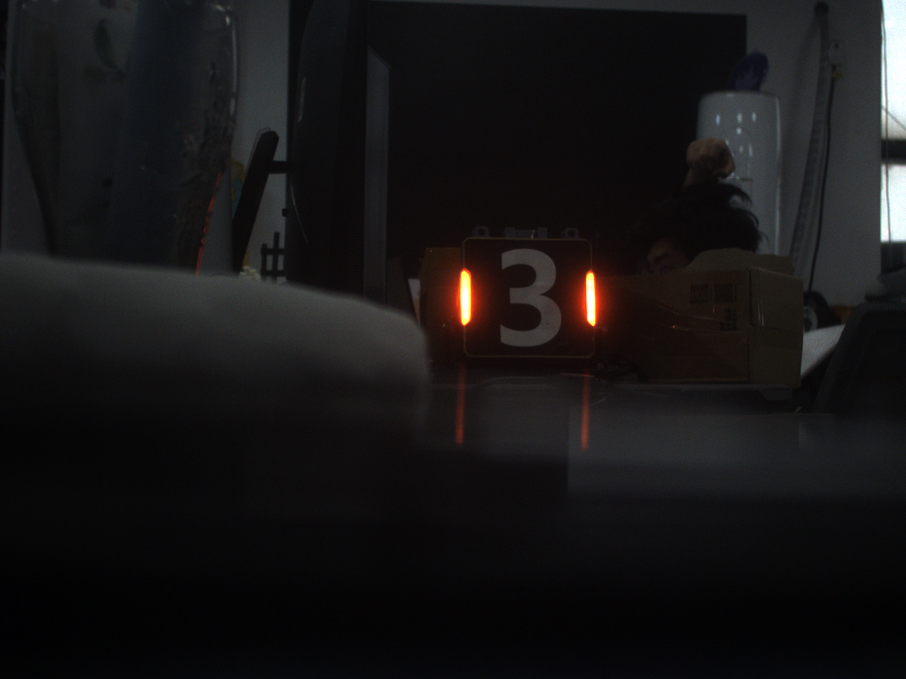
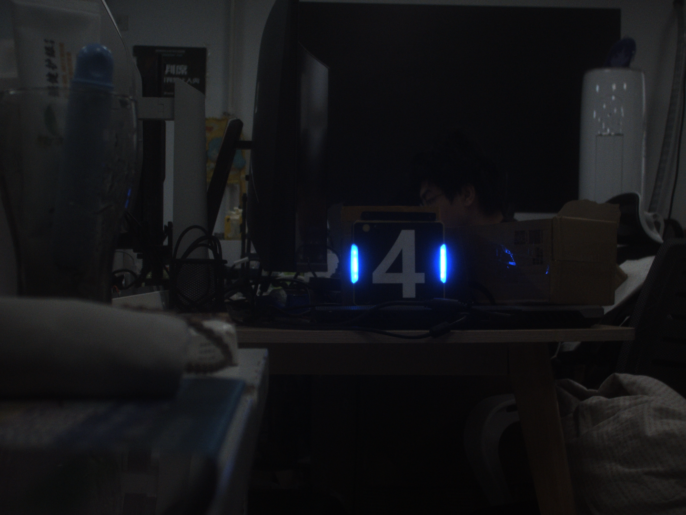

## 装甲板识别

测试用图片放在 `imgs/` 文件夹下，测试视频放在 `videos/` 文件夹下，中途测试图片可放在 `test/` 文件夹下，输出图像命名应标明内容。

本次任务要求在工业相机中识别真实的装甲板。因为这次作业需要装甲板，建议先拿 `imgs/` 里面的图片做测试，然后用 `videos/` 里面的视频做测试，最后有空可以来实验室借装甲板做实体测试（在实验室里面用，不能带走！带走了你学长就没有装甲板测自瞄啦！），我们会提供可用的工业相机驱动程序。

要求：
1. 用矩形框出装甲板或者框出两个灯条，标出其灯条端点。
2. 灯条有红色与蓝色，要求可以通过仅修改启动参数切换识别的灯条颜色。
3. 装甲板与摄像头的距离与姿态不是固定不变的，要求识别率不会因距离远近与姿态变化降低太多。
4. 识别出灯条后再标出装甲板的中心，可以在图像上画个圆点来表示装甲板中心。

装甲板灯条示意如图：



## 建议目录结构

```bash
./
├── CMakeLists.txt
├── README.md
├── imgs/                           # 测试图片
│   ├── blue_straight_ahead.png     # 正对蓝色装甲板
│   ├── blue_tilted_left.png        # 左倾蓝色装甲板
│   ├── blue_tilted_right.png       # 右倾蓝色装甲板
│   ├── red_straight_ahead.png      # 正对红色装甲板
│   ├── red_tilted_left.png         # 左倾红色装甲板
│   └── red_tilted_right.png        # 右倾红色装甲板
├── videos/                         # 测试视频
│   └── armor.avi
├── test/                           # 中途测试图片（可选）
├── include/
├── src/
│   └── armor_detector.cpp
└── build/
    └── armor_detector
```


## 注意事项

1. 尽可能地**不借助** AI 完成本次作业。
2. 完成期限为本次任务发布起**三周内**（11.21前）。
3. 任务完成后**必须**前往实验室**线下测试并答辩**。
4. 迭代过程建议使用 Git 管理，且应当撰写完整的 **README**，在其中阐述遭遇的问题与解决思路。

## 心路历程
1. 最初只提取红色区域，发现灯条中心因过曝而缺失；扩大颜色范围又引入窗户等背景。随后改成利用红色光晕确定搜索范围，再寻找附近高亮区域。最初将红色光晕和高亮核心合并，导致轮廓近似椭圆；最后只使用高亮核心提取轮廓，得到了更贴合灯条的结果。
2. 得到掩膜后，使用 `cv::findContours` 提取外轮廓。这里选择了 `RETR_EXTERNAL`，避免把灯条内部的孔洞也当成独立轮廓。在蓝色左倾图片中一共找到了 9 个轮廓，但其中 7 个只是孤立像素，用 `minAreaRect` 计算后宽和高都是0，因此先把这些退化轮廓跳过，留下了两根比较完整的灯条。
3. 普通外接矩形不能很好地描述倾斜灯条，所以改用 `cv::minAreaRect` 获取最小外接旋转矩形，再用 `rect.points` 得到四个顶点并画出矩形。这里还发现不能直接认为 `rect.size.height` 就是灯条长度，所以统一用 `max(width,height)` 表示长度，用 `min(width,height)` 表示宽度。
4. 计算灯条端点时，一开始分不清矩形顶点、灯条端点和中心点。后来确定端点取两条短边的中点：先比较两条相邻边的长度，找出两条短边，再分别求中点，并按照 `y` 坐标区分上端点和下端点。四个顶点取平均、对角线交点和 `rect.center` 表示的都是灯条中心；两根灯条配对后，再将两个 `rect.center` 取平均作为装甲板中心。
5. 红色和蓝色使用不同的HSV范围，通过启动参数 `red` 或 `blue` 选择，不需要在切换颜色时重新修改阈值和编译程序。红色的色相跨越了 0，所以需要把低红区和高红区分别提取后再合并。
6. 从macOS换到Linux后，原来的 CMake 缓存还保存着旧电脑的路径，不能直接沿用，需要重新配置构建目录。Linux环境中安装的是OpenCV5， `minAreaRect` 被移到了 `opencv2/geometry/2d.hpp`，还需要链接 `geometry` 组件。完整链接所有 OpenCV 模块时又遇到了可选模块 `viz` 缺少 VTK 依赖的问题，最后改为只链接程序实际使用的组件。测试视频则通过GitLFS下载，并将远程仓库的认证方式统一成了 HTTPS。
7. 单张图片的处理跑通后，我用ai将原main.cpp解耦代码，把识别代码从 `main()` 中移到了 `armor_detector.cpp`，由 `detectArmor` 返回是否识别成功，并通过 `outputImage` 返回标注结果。`main.cpp` 和 `video_main.cpp` 分别负责单张图片和视频，识别算法只保留一份。`lightBars` 也改成了函数内的局部变量，避免处理视频时把上一帧的灯条留到下一帧。

## 当前代码结构

- `main.cpp`：单张图片入口，负责启动参数、读写图片和调用识别函数。
- `video_main.cpp`：视频入口，负责逐帧读取、调用识别函数和写出 MP4。
- `armor_detector.hpp`：`detectArmor` 的函数声明。
- `armor_detector.cpp`：颜色分割、轮廓提取、灯条端点和装甲板中心的计算。
- `test/`：保存调试图片和输出视频，已被 Git 忽略。

## 构建与运行

当前 Linux 环境使用 CMake、支持 C++17 的编译器和 OpenCV 5。配置并编译：

```bash
cmake -S . -B build -DCMAKE_BUILD_TYPE=Debug
cmake --build build --parallel
```

运行单张图片程序：

```bash
./build/armor_detector blue
```

运行视频程序：

```bash
./build/armor_video blue
```

切换为红色时只需把启动参数改为 `red`。目前单图入口读取的是 `imgs/blue_tilted_left.png`，视频入口读取的是 `videos/Video_20261101162011859.avi`；输出分别保存为 `test/b_final_l.png` 和 `test/armor_result.mp4`。视频输出会在每次运行时覆盖，需要保留实验结果时应先另行备份。
